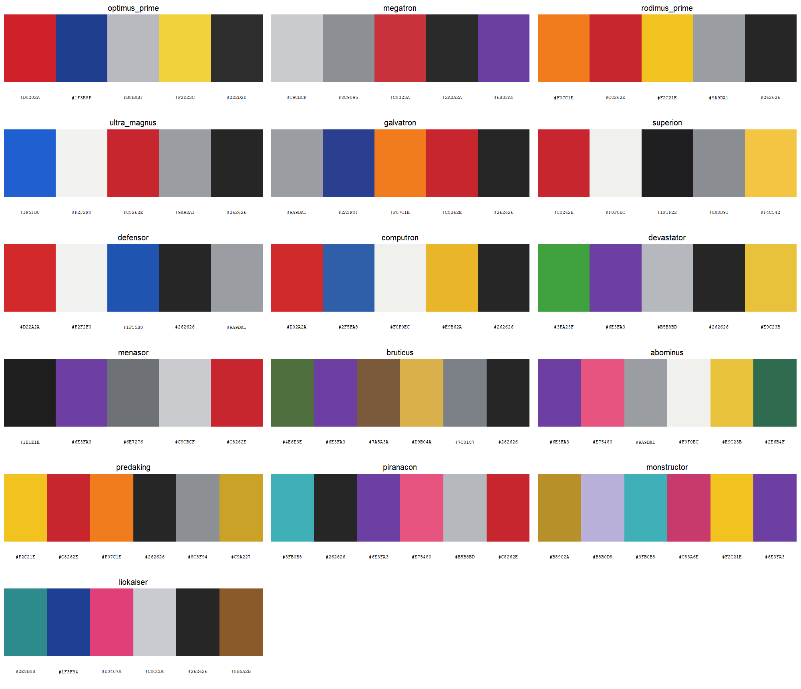
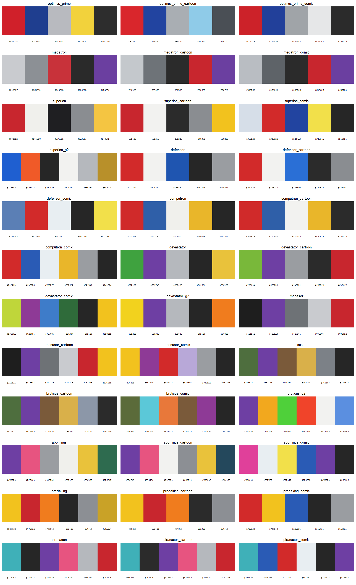
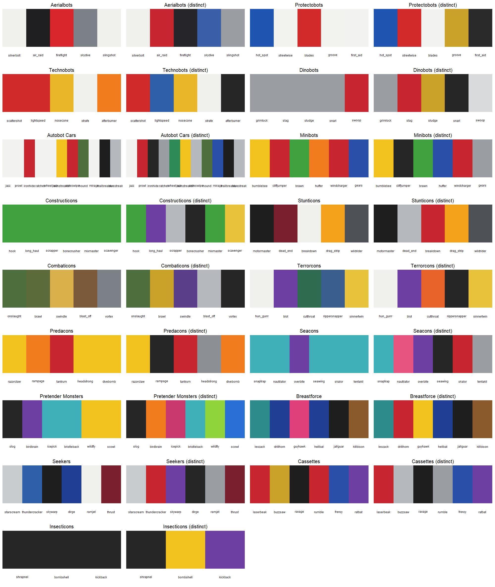
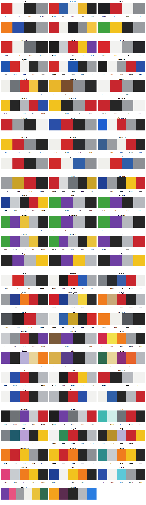
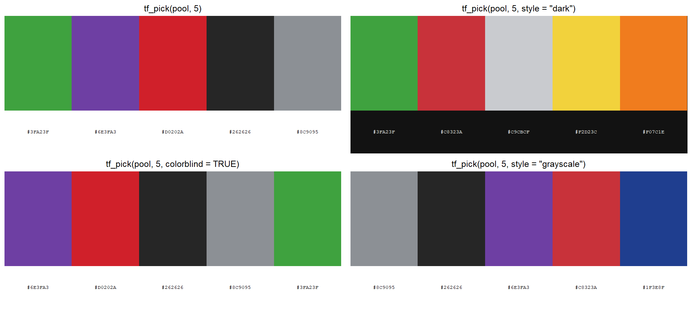

# transformerpalettes

<!-- badges: start -->
[](https://github.com/bmaitner/transformerpalettes/actions/workflows/R-CMD-check.yaml)
<!-- badges: end -->

Color palettes for R and ggplot2 drawn from the Transformers franchise,
centered on the Generation 1 toys and extending to their Generation 2
re-releases, the cartoon animation models and the Marvel comics. It covers
Optimus Prime, Megatron, every member and combined form of the combiner
teams from the Aerialbots and Superion to the Seacons and Piranacon, and the
rest of the 1984-1989 cast. Each character has a palette for the original
toy, most have one for the cartoon, many have one for the comic, and the
teams Hasbro recolored for Generation 2 have one for that, because the
sources often disagree about what color a robot is. It works the same way as
packages like `wesanderson`: pick a character by name, get a vector of hex
colors, or drop a scale straight into a ggplot. Because the combiner teams
are sets of five or six figures, each team also gives a ready-made
categorical palette with one color per member.

transformerpalettes is a fan project and is not affiliated with or endorsed by
Hasbro or Takara Tomy. Hex values are approximations of the toys' plastic,
chrome and paint colors; see "How the palettes were made" below.

## Browse online

Every palette, with its colors, toy photo and Transformers Wiki link, is
browsable and filterable at
<https://bmaitner.github.io/transformerpalettes/articles/browse.html>. Each card has
a **Suggest a change** link that opens a prefilled GitHub issue, and there is
a form to [request a character](https://github.com/bmaitner/transformerpalettes/issues/new?template=new-character.yml)
who is not covered yet. [`WISHLIST.md`](https://github.com/bmaitner/transformerpalettes/blob/main/WISHLIST.md) lists what is queued.

## Installation

```r
# install.packages("pak")
pak::pak("bmaitner/transformerpalettes")
```

## Usage

```r
library(transformerpalettes)

# what is covered
tf_media()
tf_factions()
tf_teams()
table(tf_characters$team, tf_characters$medium)

# palette names, optionally for one faction, team or role
tf_palette_names()
tf_palette_names(team = "Constructicons")
tf_palette_names(role = "combined form")

# the colors of one character (prints the swatches and the hex codes)
tf_palette("optimus_prime")
#> Transformers palette 'optimus_prime' (5 colors, toy)
#> Autobot: Optimus Prime
#> #D0202A #1F3E8F #B8BABF #F2D23C #2D2D2D

# first three colors, a 12-step gradient, or the same gradient dark-to-light
tf_palette("Megatron", 3)
tf_palette("devastator", 12, type = "continuous")
tf_palette("hot_spot", 12, type = "continuous", sort = TRUE)

# swatches with hex codes, for a team or faction at a time
tf_show_palettes(team = "Aerialbots")
tf_show_palettes(faction = "Decepticon", role = "combined form", ncol = 3)
```



### Toy, cartoon or comic

Every function takes a `medium` argument that defaults to `"toy"`, so the
plain names always give the toy colors. Ask for `"cartoon"` to get the flat
colors of the Sunbow animation model, `"comic"` for the Marvel coloring
where one exists, or `"g2"` for the Generation 2 re-release of the three
combiner teams Hasbro recolored in 1992-94. The full names with a suffix
work too.

```r
tf_palette("drag_strip")                      # yellow-orange and plum toy
tf_palette("drag_strip", medium = "cartoon")  # yellow and purple cartoon model
tf_palette("megatron_comic")                  # same as medium = "comic"

tf_palette_names(medium = "cartoon")
tf_palette_names(role = "leader", medium = "all")
tf_show_palettes(c("optimus_prime", "optimus_prime_cartoon", "optimus_prime_comic"), ncol = 1)
tf_team_palette("Constructicons", medium = "cartoon")   # lime green, not grass green
tf_team_palette("Combaticons", medium = "g2")           # 1994 camouflage colors
```



Every character has a cartoon palette; the Seacons' comes from the Japanese
Super-God Masterforce series, since they never appeared in the Sunbow show.
Comic palettes exist for the two leaders and all nine core combiner teams,
each sampled from a named Marvel US or UK story that the browser links to.
Marvel coloring changed from issue to issue (and Marvel UK recolored the
same art), so treat them as one issue's reading rather than a canon. The
Pretender Monsters have no cartoon palette because they never appeared in
one; [`WISHLIST.md`](https://github.com/bmaitner/transformerpalettes/blob/main/WISHLIST.md) lists what is still open.
Asking for a medium a character does not have yet gives an error that says
so.

### Team palettes

`tf_team_palette()` takes one color from each member of a combiner team, in
the team's order (torso first, then limbs), and names each color after the
member it came from. The body colors are faithful but collapse for teams
cast from shared plastics, so `distinct = TRUE` picks, for each member, the
color from its palette that is furthest from the colors chosen so far.

```r
tf_team_palette("Stunticons")
#> Transformers team palette 'stunticons' (5 colors)
#> motormaster = #1E1E1E
#> dead_end = #7A1F2E
#> breakdown = #F0F0EC
#> drag_strip = #F2C21E
#> wildrider = #4E5257

tf_team_palette("Constructicons")                  # six shades of green
tf_team_palette("Constructicons", distinct = TRUE) # green, purple, silver, ...
```



### ggplot2

`scale_colour_tf()` and `scale_fill_tf()` build a discrete scale by default,
or a continuous gradient with `discrete = FALSE`. The explicit `_d` and `_c`
variants and the American `scale_color_*` spellings are also exported.
`sort = TRUE` on a continuous scale orders the palette from darkest to
lightest first. Team palettes go through `scale_colour_manual()`.

```r
library(ggplot2)

ggplot(mpg, aes(displ, hwy, colour = drv)) +
  geom_point(size = 2.5) +
  scale_colour_tf("optimus_prime")

ggplot(diamonds, aes(cut, fill = cut)) +
  geom_bar() +
  scale_fill_tf("predaking")

ggplot(faithfuld, aes(waiting, eruptions, fill = density)) +
  geom_raster() +
  scale_fill_tf_c("hot_spot", sort = TRUE)

ggplot(economics_long, aes(date, value01, colour = variable)) +
  geom_line() +
  scale_colour_manual(values = unname(tf_team_palette("Combaticons")))

ggplot(mpg, aes(displ, hwy, colour = drv)) +
  geom_point(size = 2.5) +
  scale_colour_tf("optimus_prime", medium = "cartoon")
```


Set `reverse = TRUE` to flip a palette. If a discrete variable has more levels
than a palette has colors, the palette is interpolated so every level still
gets a color, at some cost to legibility.

### Finding a palette that works for a plot

Toy colors were chosen to look good on a shelf, not on a chart.
`tf_find_palettes()` shortlists the palettes whose colors hold up for a
given job, judged from the colors themselves:

```r
tf_find_palettes("categorical")   # every pair of colors clearly distinct
tf_find_palettes("colorblind")    # still distinct under simulated CVD
tf_find_palettes("sequential")    # one hue, wide lightness range
tf_find_palettes("diverging")     # two hues with a light color between

# restrict to a faction or team, or see the shortlist as swatches
tf_find_palettes("colorblind", faction = "Autobot")
tf_show_palettes(use = "colorblind", ncol = 3)
```



The judgments come from `tf_palette_stats()`, which reports the smallest
pairwise distance between colors in CIE Lab, the same after simulating
deuteranopia, protanopia and tritanopia, the lightness range, and the hue
spread. The thresholds are simple heuristics, so treat the result as a
shortlist to look at rather than a guarantee.

### Picking the best few colors from one or more palettes

Whole palettes are faithful to the characters, not to the chart. `tf_pick()`
pools the colors of the palettes you name, drops any that would not read
against the background (white for `"light"` and `"greyscale"`, near-black
for `"dark"`, judged by WCAG contrast), and then chooses the `n` colors
whose closest pair is farthest apart in CIE Lab. With `colorblind = TRUE`
the distance is the worst case across simulated deuteranopia, protanopia and
tritanopia; with `style = "greyscale"` only lightness counts, so the result
survives a black-and-white printer.

```r
# five colors for a white-background plot, from the two leaders
tf_pick(c("optimus_prime", "megatron"), n = 5)
#> Transformers pick of 5 colors from optimus_prime + megatron
#> light background #FFFFFF, min distance 21.7
#> optimus_prime = #D0202A
#> optimus_prime = #1F3E8F
#> megatron = #8C9095
#> megatron = #2A2A2A
#> megatron = #6B3FA0

# four color-blind-safe colors for a dark theme, from a whole team
tf_pick(tf_palette_names(team = "Combaticons"), n = 4,
        style = "dark", colorblind = TRUE)

# printable in grayscale, using the cartoon colors
tf_pick(tf_palette_names(team = "Stunticons"), n = 4,
        style = "greyscale", medium = "cartoon")

ggplot(mpg, aes(displ, hwy, colour = drv)) +
  geom_point(size = 2.5) +
  scale_colour_manual(values = unname(tf_pick(c("optimus_prime", "megatron"), 3)))
```



Each color is named after the palette it came from, and the `min_distance`
attribute reports how separable the closest pair is (above 20 is
comfortable, below about 12 is risky). The contrast filter is strict on
purpose: saturated yellows fail it against white, so a light-mode pick from
the Predacons has fewer colors to work with. Lower `min_contrast` to keep
them, or pass a different `background`.

### Crediting the sources

The colors belong to the toys, cartoons and comics they came from, so give
them a line. `tf_credit()` writes that line from the palette metadata,
grouped by medium, and follows a `tf_pick()` or `tf_team_palette()` result
back to every character that contributed. The caption form is one sentence;
the acknowledgment form adds that the hex values are approximations that
imply no endorsement, which is the wording journals tend to want. Cite the
package itself with `citation("transformerpalettes")`.

```r
tf_credit("optimus_prime")
#> [1] "Colors: Optimus Prime toy colorway by Hasbro and Takara Tomy, via the transformerpalettes R package."

tf_credit(tf_team_palette("Stunticons"))
#> [1] "Colors: Motormaster, Dead End, Breakdown, Drag Strip and Wildrider toy colorways by Hasbro and Takara Tomy, via the transformerpalettes R package."

tf_credit(c("optimus_prime", "megatron_cartoon"))
#> [1] "Colors: Optimus Prime toy colorway by Hasbro and Takara Tomy and Megatron cartoon colors from the Generation 1 animated series, via the transformerpalettes R package."

tf_credit("optimus_prime", format = "acknowledgment")
#> [1] "Figure colors are derived from the Optimus Prime toy colorway designed by Hasbro and Takara Tomy. Hex values are approximations from the transformerpalettes R package (Maitner 2026) and imply no endorsement by Hasbro or Takara Tomy."

# straight into a figure caption
cols <- tf_pick(c("optimus_prime", "megatron"), n = 3)
ggplot(mpg, aes(displ, hwy, color = drv)) +
  geom_point(size = 2.5) +
  scale_color_manual(values = unname(cols)) +
  labs(caption = tf_credit(cols))
```

`format = "markdown"` links each character to its Transformers Wiki page,
for Quarto and R Markdown captions, and `package = FALSE` drops the package
mention when it is cited elsewhere.

### Character background

`tf_characters` is a data frame with one row per palette: the character,
which medium the palette records, faction, combiner team and combined form,
its role in the team, alternate mode, the year of the toy or first
appearance, a description of the colors, and links to the character's page
and the reference image (toy photo, episode still or comic panel) on the
Transformers Wiki.

```r
t(tf_characters[tf_characters$palette == "drag_strip", ])
#> palette     "drag_strip"
#> base        "drag_strip"
#> medium      "toy"
#> character   "Drag Strip"
#> faction     "Decepticon"
#> team        "Stunticons"
#> combiner    "menasor"
#> role        "combiner limb"
#> alt_mode    "Tyrrell P34 six-wheeled race car"
#> year        "1986"
#> n_colours   "5"
#> description "Yellow-orange race car plastic with dark plum head and blaster, ..."
#> source      "https://tfwiki.net/wiki/Drag_Strip_(G1)"
#> image       "https://tfwiki.net/mediawiki/images2/c/c2/G1Dragstrip_toy.jpg"
```

## Coverage

| Team | Faction | Members | Combined form | Year | Media |
|---|---|---|---|---|---|
| (leaders) | both | Optimus Prime, Megatron | | 1984 | toy, cartoon, comic |
| Aerialbots | Autobot | Silverbolt, Air Raid, Fireflight, Skydive, Slingshot | Superion | 1986 | toy, cartoon, comic, g2 |
| Protectobots | Autobot | Hot Spot, Streetwise, Blades, Groove, First Aid | Defensor | 1986 | toy, cartoon, comic |
| Technobots | Autobot | Scattershot, Lightspeed, Nosecone, Strafe, Afterburner | Computron | 1987 | toy, cartoon, comic |
| Dinobots | Autobot | Grimlock, Slag, Sludge, Snarl, Swoop | (subgroup) | 1985 | toy, cartoon |
| Constructicons | Decepticon | Hook, Long Haul, Scrapper, Bonecrusher, Mixmaster, Scavenger | Devastator | 1985 | toy, cartoon, comic, g2 |
| Stunticons | Decepticon | Motormaster, Dead End, Breakdown, Drag Strip, Wildrider | Menasor | 1986 | toy, cartoon, comic |
| Combaticons | Decepticon | Onslaught, Brawl, Swindle, Blast Off, Vortex | Bruticus | 1986 | toy, cartoon, comic, g2 |
| Terrorcons | Decepticon | Hun-Gurrr, Blot, Cutthroat, Rippersnapper, Sinnertwin | Abominus | 1987 | toy, cartoon, comic |
| Predacons | Decepticon | Razorclaw, Rampage, Tantrum, Headstrong, Divebomb | Predaking | 1986 | toy, cartoon, comic |
| Seacons | Decepticon | Snaptrap, Nautilator, Overbite, Seawing, Skalor, Tentakil | Piranacon | 1988 | toy, cartoon (Masterforce), comic |
| Seekers | Decepticon | Starscream, Thundercracker, Skywarp, Dirge, Ramjet, Thrust | (subgroup) | 1984-85 | toy, cartoon |
| Pretender Monsters | Decepticon | Slog, Birdbrain, Icepick, Bristleback, Wildfly, Scowl | Monstructor | 1989 | toy |
| Breastforce | Decepticon | Leozack, Drillhorn, Guyhawk, Hellbat, Jallguar, Killbison | Liokaiser | 1989 (Takara) | toy, cartoon (Victory) |
| Cassettes | Decepticon | Laserbeak, Buzzsaw, Ravage, Rumble, Frenzy, Ratbat | (subgroup) | 1984-86 | toy, cartoon |
| Insecticons | Decepticon | Shrapnel, Bombshell, Kickback | (subgroup) | 1985 | toy, cartoon |
| Autobot Cars | Autobot | Jazz, Prowl, Ironhide, Ratchet, Wheeljack, Sunstreaker, Sideswipe, Hound, Mirage, Trailbreaker, Bluestreak | (subgroup) | 1984 | toy, cartoon |
| Minibots | Autobot | Bumblebee, Cliffjumper, Brawn, Huffer, Windcharger, Gears | (subgroup) | 1984 | toy, cartoon |
| (standalone) | both | Shockwave, Soundwave, Hot Rod, Rodimus Prime, Ultra Magnus, Kup, Blurr, Springer, Wreck-Gar, Galvatron, Cyclonus, Scourge, Gnaw | | 1984-86 | toy, cartoon |

Palette names are the character's name in snake_case (`hun_gurrr`,
`blast_off`); `tf_palette()` also accepts `"Hun-Gurrr"` and
`"Blast Off"`. Every team is drawn in `man/figures/palettes-<team>.png`
(spaces in a team name become hyphens).
Characters and teams that are lined up to be added next are listed in
[`WISHLIST.md`](https://github.com/bmaitner/transformerpalettes/blob/main/WISHLIST.md); add a line there, or open a
[request](https://github.com/bmaitner/transformerpalettes/issues/new?template=new-character.yml).

## How the palettes were made

There is no published set of hex values for Transformers toys, so these are
approximations built by hand:

1. Each character was matched to its original Hasbro release on the
   [Transformers Wiki](https://tfwiki.net/wiki/Main_Page), and to the wiki's photo of that
   toy in robot mode. The page and the photo are the `source` and `image`
   columns of `tf_characters`.
2. The plastic, chrome, die-cast and paint colors of that toy were listed
   from the photo and the wiki's own description of the release, and a hex
   value chosen for each by eye. Colors are ordered body plastic first, then
   secondary plastic, then accents, so the first few colors in each palette
   are the most distinct.
3. Members of one combiner team share plastics, so their palettes share hex
   values on purpose. The combined form's palette takes one color from each
   contributing part.

Cartoon palettes were read the same way from an episode still on the wiki,
which the browser links to; they use the flat colors of the animation model,
so a cartoon palette is typically brighter and simpler than its toy. Comic
palettes name the Marvel issue they were taken from.

Palettes range from four to six colors. Chrome and die-cast parts do not
reduce to a single flat color; a silver or gray stands in for them. Wiki
photos vary in lighting, so expect some palettes to be rough, and the least
certain ones are flagged in [`WISHLIST.md`](https://github.com/bmaitner/transformerpalettes/blob/main/WISHLIST.md). Corrections are
welcome, ideally with a photograph of the toy under neutral light. Use the
[palette browser](https://bmaitner.github.io/transformerpalettes/articles/browse.html)
to open a prefilled issue for a specific palette, or pick a form from the
[issue templates](https://github.com/bmaitner/transformerpalettes/issues/new/choose).
`tf_show_palettes()` prints the hex codes under each swatch to make reporting
easy.

## Trademarks

Transformers, Autobot, Decepticon and the character names used here are
trademarks of Hasbro and Takara Tomy. This package only records approximate
color values and uses the names to refer to them.
